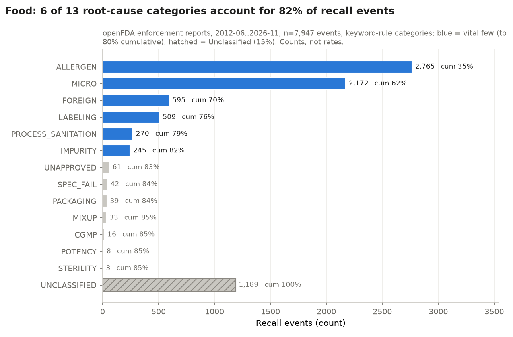
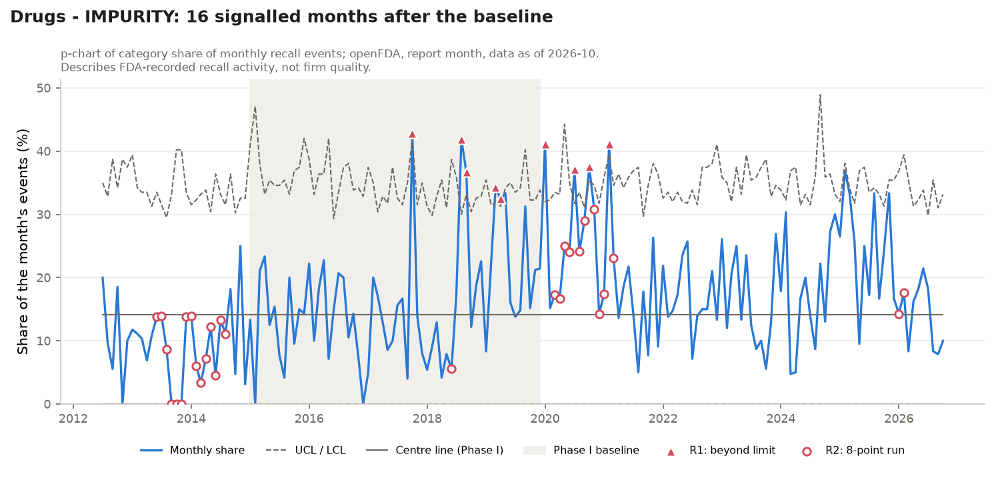

# FDA Recall & Quality Risk Dashboard

[](https://github.com/raynesko/fda-recall-quality-risk-dashboard/actions/workflows/ci.yml)

-yellow)
[](LICENSE)

**Which stated failure modes drive FDA drug and food recalls, which are shifting beyond normal variation, and what should a QA function look at?** This repo answers that from public openFDA enforcement data. It classifies recall reasons into root-cause categories, applies Pareto, control charts and trend tests, evaluates a transparent risk score against naive baselines, and frames the result in DMAIC with QA actions. The output is a 4-page Power BI dashboard.




**Headline results** (all *achieved* values, from `results/metrics.json`):

| | Result | Key |
|---|---|---|
| Recall events analyzed | **12,687** drug + food events (report dates 2012-06-20 to 2026-11-04) | `data.n_events`, `data.report_date_min/max` |
| Vital few | **8 of 13** drug categories and **6 of 13** food categories account for **82.5%** of events | `pareto.*.vital_few_k`, `pareto.*.vital_few_share` |
| Risk score backtest | **Did not beat** naive baselines (precision@3 0.235 vs 0.382 for random), so it is reported as a triage view, not a forecast | `backtest.p_at_3`, `backtest.best_baseline_p_at_3`, `backtest.target_met` |

## Dashboard
A 4-page Power BI report, generated as text (PBIP: TMDL semantic model + PBIR report) by `src/fda_recall/pbip.py`, so every visual, measure and layout rule is reviewable in git and rebuilt from code. Visuals read precomputed Python tables, so dashboard numbers reconcile with `results/metrics.json` instead of being recalculated in DAX.

| Page | Question it answers | What is on it |
|---|---|---|
| 1 Executive summary | How much recall activity is there, and is it changing? | Trailing-12-month event count, change vs prior 12 months, Class I share, number of flagged categories; monthly trend by product type; product, class and date slicers |
| 2 Pareto | Which stated failure modes drive most events? | Drug and food Pareto charts (count, severity-weighted or Class-I-only; full period or trailing 60 months); click a bar to list its FDA records |
| 3 Control charts | Is a category unusual versus its 2015-2019 baseline? | Selectable c- or p-chart with centre line, Laney-adjusted limits and highlighted signals; table of signal months; top-6 small multiples |
| 4 Risk watchlist | Which failure modes deserve QA attention now? | Ranked categories with score, stability % and plain-language "why flagged"; weighted score components; DMAIC QA actions with owner, metric and CFR citation for the selected category; backtest result and limitations on the page |

Page 1 shows the data-as-of date, and every page states that counts are recall events, not rates. Test protocol: `docs/dashboard/test-checklist.md`; reconciliation sheet: `docs/dashboard/reconciliation.md`.

## 1. Problem
QA and regulatory-intelligence teams in food and pharma want to learn from industry recalls. Each FDA enforcement record holds a free-text `reason_for_recall`, so seeing patterns means reading thousands of records. This project turns those records into a classified, statistically monitored view.

It measures **FDA-recorded recall events**. These are counts, not failure rates, and the project says nothing about any individual firm.

## 2. Method
```
openFDA bulk download -> clean & dedupe to events -> classify reason (keyword rules) -> Pareto
   -> monthly series -> c/p control charts (Laney) + trend tests -> risk score -> backtest + sensitivity
   -> DMAIC QA action library -> dashboard tables -> generated Power BI project (PBIP)
```
- **Data:** openFDA drug and food enforcement endpoints, bulk files. Raw files are immutable, with a SHA-256 manifest. Product rows are deduplicated to the recall-event grain. Details: `docs/data/`.
- **Taxonomy:** 14 categories of stated failure mode with tie-break priority (`data/reference/taxonomy.yaml`, `docs/domain/root-cause-taxonomy.md`).
- **Classification:** a frozen keyword-rule baseline was compared with TF-IDF + logistic regression on a 300-event LLM-annotated gold set (`labels.n_gold`), using cross-validation grouped by firm.
  - **The rules won:** macro-F1 0.802 vs 0.677 (`clf.rules_macro_f1_all`, `clf.ml_macro_f1_all`). They are the production classifier.
  - Events no rule matches are shown as **UNCLASSIFIED**, never forced into a category.
- **Pareto:** count, severity-weighted and Class-I-only views, with ranking robustness measured by Kendall tau.
- **SPC:**
  - c-chart on monthly counts and p-chart on category share, with Laney adjustment for overdispersion. Phase I baseline 2015-01..2019-12; rules R1 (beyond limit) and R2 (8-point run).
  - False-alarm rates were measured by simulation, because textbook 3-sigma rates do not hold for low counts.
- **Trend tests:** Poisson or negative-binomial GLM with Benjamini-Hochberg correction.
- **Risk score:** transparent weighted percentiles of momentum, severity, SPC signal, breadth and volume.
  - **Pre-registered** before any backtest; the document's hash was recorded (`risk.preregistration_sha256`).
  - Backtested over 10 yearly origins against volume, momentum and random baselines.
  - Sensitivity checks: weights, window length and label noise.
- **DMAIC:** 12 categories × 5 phases of QA actions with owner, metric and CFR citation. 56 of 60 citations were verified (`docs/domain/qa-action-library.md`).

Full write-up: `docs/methodology/methodology-and-limitations.md`.

## 3. Results
**Classification.** Values are on the gold set unless noted.

| Model | Macro-F1 | Note |
|---|---|---|
| Keyword rules (production) | 0.802 | precision on accepted predictions 0.895; 0.893 of all events classified (`clf.prod_precision_accepted_all`, `clf.corpus_coverage`) |
| TF-IDF + logistic regression | 0.677 | difference −0.126, 95% CI −0.173 to −0.050 (`clf.uplift_ci_all`) |

Label agreement between two independent LLM annotators: kappa 0.981 on 60 events (`labels.kappa_llm_a_vs_b`). Treat this as an upper bound; see limitation 3.

**Pareto.**
- Drugs: impurity, specification failure, sterility, potency, foreign material, labeling, mix-up and CGMP make up the vital few (`pareto.drugs.vital_few`).
- Food: allergen, microbial, foreign material, labeling, process/sanitation and impurity (`pareto.food.vital_few`).
- Unclassified: 0.15 of food events and 0.035 of drug events (`pareto.*.unclassified_share`).

**Control charts and trends.**
- 16 series are monitored (`spc.n_categories`).
- After the baseline, 91 p-chart signals across 13 series (`spc.n_signals`, `spc.n_categories_with_signal`). This count swings from 39 to 192 depending on the baseline window (`spc.window_signal_range`).
- Simulation: at 1 event per month, rule-1 false alarms run 0.0081 per point, against the textbook 0.0027 (`spc.sim_lambda1.r1_per_point`).
- No category trend is significant after correction (`trend.n_significant_q05` = 0 of 19).



**Risk score (honest negative result).** precision@3 over 10 yearly origins (`backtest.n_origins`), the share of each method's top-3 picks that were among the 3 categories with the largest next-year increase (averaged over origin × product type):

| Method | precision@3 | Key |
|---|---|---|
| Random selection (expected) | 0.382 | `backtest.p_at_3.B3_random_expected` |
| Volume baseline (biggest categories) | 0.314 | `backtest.p_at_3.B1_volume` |
| **Pre-registered risk score** | **0.235** | `backtest.p_at_3.score` |
| Momentum baseline (biggest recent rise) | 0.176 | `backtest.p_at_3.B2_momentum` |

- precision@3: 0.235 vs 0.382 for random selection.
- Spearman ρ between score and next-year change: −0.308, 95% CI −0.446 to −0.184 (`backtest.spearman_rho`, `_ci`).
- Momentum alone had ρ −0.37 (`backtest.momentum_rho`): categories that just rose tended to fall back (**regression to the mean**).
- Target **missed** (`backtest.target_met`). The weights were not re-tuned. The score is used to triage attention.
- Weight sensitivity: median tau 0.735 (`sens.median_tau_weights`). 7 categories are currently flagged (`risk.latest_n_flagged`), and fragile flags are named on the dashboard.

**What a QA team would do with this.** Use the Pareto to choose which failure modes to benchmark internal deviations and CAPA trends against (allergen and microbial controls in food; impurity, specification and sterility in drugs). Use control-chart signals as prompts to review, not as proof of a problem. Use the watchlist to triage attention, checking stability before acting, and take the DMAIC action library as a starting checklist to adapt to a site's own quality system.

**Targets** (from `docs/01-project-charter.md`; *target* ≠ *achieved*):
- Missed: ML macro-F1 ≥ 0.80, ML uplift ≥ +0.10, precision on accepted predictions ≥ 0.90 (narrowly), and risk-score lift ≥ +0.15.
- Met: kappa ≥ 0.75 (upper bound) and weight-sensitivity tau ≥ 0.70.
- Pending: dashboard reconciliation and usability.

## Verification and reproducibility
- **Tests:** 73 pytest tests, analysis functions checked on toy data with hand-computed answers (Pareto, SPC limits and rules, trend tests, risk score, backtest, classifier, labeling agreement, dashboard layout). Tests that need the processed openFDA data skip in CI. CI also runs `ruff` and validates the Power BI files against Microsoft's PBIR JSON schemas.
- **No leakage:** the backtest uses only data available at each origin date, checked in code (`backtest.leakage_check_passed` = true). Classifier cross-validation is grouped by recalling firm, and the keyword rules were written from the taxonomy and EDA, never from the gold labels.
- **Pre-registration:** the risk-score definition and success criteria were committed before the backtest ran. The backtest re-hashes that document and confirms it is unchanged (`backtest.preregistration_hash_match` = true).
- **Single source of numbers:** every figure in this README, the dashboard and the portfolio material comes from `results/metrics.json`, written only by pipeline code (`python scripts/resume_numbers.py` lists each one with its key). Targets that were missed are reported as missed, not re-tuned.
- **Reproducible from raw:** a fresh virtual environment ran the full 17-step pipeline from the immutable raw files and reproduced all 102 metrics exactly (2026-11-17).
- **Dashboard:** the TMDL model is parsed with Microsoft's own TOM serializer (`scripts/validate_tmdl.ps1`), and generator checks catch measure/column name collisions before Power BI does.

## 4. How to run
Requires Windows, macOS or Linux with Python 3.12. Power BI Desktop is needed only for the dashboard.
```bash
git clone https://github.com/raynesko/fda-recall-quality-risk-dashboard.git && cd fda-recall-quality-risk-dashboard
python -m venv .venv
.venv\Scripts\activate            # macOS/Linux: source .venv/bin/activate
pip install -r requirements.txt     # pinned; full lock in requirements-lock.txt
python scripts/run_pipeline.py --download   # fetch openFDA bulk files, then run all 17 steps (~4 min after download)
pytest -q                           # 73 tests
python scripts/resume_numbers.py    # every published number with its metrics key
```
- **Dashboard:** open `dashboard/FDA_Recall_Dashboard.pbip` in Power BI Desktop, then click **Refresh**.
  - The project is generated by `python -m fda_recall.pbip`.
  - Validate it with `python scripts/validate_pbir.py` (JSON schemas) and `powershell -File scripts\validate_tmdl.ps1` (TMDL).
- **Optional API key:** set the environment variable `OPENFDA_API_KEY`. Never commit it.
- **Backlog for agents:** `python scripts/tickets.py next` (see `CLAUDE.md`).

## 5. Assumptions
- **Unit:** the recall event (`event_id`); one event can cover many products.
- **Month:** `report_date` month (when FDA posted the recall). Initiation-date month is a sensitivity series with a 6-month truncation from the 160-day P90 reporting lag (`data.lag_p90_days`).
- **Severity weights:** Class I/II/III = 3/2/1 (ordinal, arbitrary), always shown alongside a Class-I-only view.
- **Categories:** describe FDA's *stated* reason, not a verified root cause.
- **Risk-score weights:** 0.35/0.25/0.20/0.10/0.10, chosen a priori and not tuned.

## 6. Limitations
1. **No denominator:** counts are not failure rates.
2. **Selection and enforcement bias:** FDA priorities and reporting cadence shape the data.
3. **LLM-produced labels:** both annotators were LLMs, and the same author wrote the rules, so accuracy and kappa are likely optimistic. A human spot check is recommended.
4. **Classifier error:** about 10% of accepted predictions are wrong; 15% of food events are Unclassified.
5. **Stated reason ≠ root cause.**
6. **Small-n backtest:** 10 origins.
7. **SPC is baseline-dependent:** low counts inflate false alarms.
8. **Reporting lag:** see Assumptions.
9. **Scope:** excludes USDA-FSIS meat, poultry and egg products, devices and biologics; data starts 2012-06.
10. **Arbitrary severity weights.**
11. **Window-dependent risk ranking.**
12. **Status field:** recorded at classification time and not updated.

Details and their effect on interpretation: `docs/methodology/methodology-and-limitations.md`.

## Repo map
| Path | Contents |
|---|---|
| `src/fda_recall/` | Pipeline package: ingest, clean, star schema, `classify/`, `analysis/` (Pareto, SPC, trends), `risk/` (score, backtest, sensitivity), `labeling/`, dashboard tables and the PBIP generator |
| `scripts/` | `run_pipeline.py` (all 17 steps), `resume_numbers.py`, PBIR/TMDL validators, `tickets.py` backlog CLI |
| `tests/` | pytest suite (toy data, no network) |
| `data/reference/` | Root-cause taxonomy, keyword rules, DMAIC QA action library |
| `data/labels/` | 300-event gold set, independent relabel for agreement, 30-event spot check |
| `reports/` | Generated reports (data quality, classifier evaluation, error analysis, backtest, sensitivity), figures and tables |
| `results/metrics.json` | The single source of every published number |
| `dashboard/` | Generated Power BI project (`.pbip`) and theme |
| `docs/` | Charter, plan, domain primers, methodology and limitations, dashboard docs, portfolio material |
| `tickets/` | Backlog used to run the project, one file per ticket |

## Data sources and citations
- openFDA drug enforcement and food enforcement APIs: https://open.fda.gov/apis/ (public domain; see openFDA terms).
- Regulatory structure: 21 CFR Parts 7, 211 and 117 via the Cornell LII mirror. Section-level verification status is in `docs/domain/fda-recall-primer.md` and `docs/domain/qa-action-library.md`.

## Disclaimer
This is a portfolio project built on public openFDA data and **not for clinical or regulatory decisions**. Patterns describe categories of FDA-recorded recall events, not the quality of any named firm. openFDA data may be incomplete or delayed; FDA does not endorse this work.

MIT license (`LICENSE`). Built from public openFDA data only; no proprietary or confidential data.
