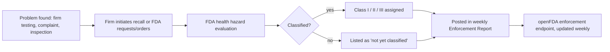

# FDA Recall System Primer and Data-Limitations Memo (T1.1.1)

Sources were fetched on 2026-11-15. Claims are tagged to a URL. Anything I could not confirm from a primary page is marked **UNVERIFIED**. eCFR pages could not be fetched (bot-check redirect), so CFR structure below comes from Cornell LII mirrors of the CFR (secondary mirror, not the official eCFR) and section-level titles are mostly UNVERIFIED.

## 1. Recall classes (FDA)
From FDA's recall background page (https://www.fda.gov/safety/industry-guidance-recalls/recalls-background-and-definitions):
- **Class I** - a reasonable probability that use of or exposure to a violative product will cause serious adverse health consequences or death.
- **Class II** - use of or exposure to a violative product may cause temporary or medically reversible adverse health consequences, or the probability of serious consequences is remote. (Second half paraphrased by the fetch tool; exact wording UNVERIFIED - re-read the page before quoting.)
- **Class III** - use of or exposure to a violative product is not likely to cause adverse health consequences.
- The class reflects FDA's assessment of **relative degree of health hazard**, not firm size or number of units (https://www.fda.gov/safety/recalls-market-withdrawals-safety-alerts/enforcement-reports).

## 2. Who initiates a recall
FDA's page says recalls can occur on a firm's **own initiative** (voluntary), **by FDA request**, or **by FDA order under statutory authority** (mandated) (https://www.fda.gov/safety/industry-guidance-recalls/recalls-background-and-definitions). Which of these is recorded in the data is a field to verify in T2.1.1 (`voluntary_mandated`, UNVERIFIED).

## 3. Regulatory framework (structure only)
- **21 CFR Part 7, Subpart C - Recalls (including Product Corrections)**: sections listed on the LII mirror (https://www.law.cornell.edu/cfr/text/21/part-7/subpart-C): 7.40 Recall policy; 7.41 Health hazard evaluation and recall classification; 7.42 Recall strategy; 7.45 FDA-requested recall; 7.46 Firm-initiated recall; 7.49 Recall communications; 7.50 Public notification of recall; 7.53 Recall status reports; 7.55 Termination of a recall; 7.59 General industry guidance. Section text not read; the definition of recall classes (7.3(m)) was not retrievable - UNVERIFIED.
- **21 CFR Part 211 - Current Good Manufacturing Practice for Finished Pharmaceuticals** (https://www.law.cornell.edu/cfr/text/21/part-211). Subparts confirmed: B Organization and Personnel (211.22-211.34); F Production and Process Controls (211.100-211.115); I Laboratory Controls (211.160-211.176); J Records and Reports (211.180-211.198). Titles of individual sections 211.22, .113, .165, .166, .192 are UNVERIFIED. Part 210 (general cGMP for drugs) not fetched - UNVERIFIED.
- **21 CFR Part 117 - Current Good Manufacturing Practice, Hazard Analysis, and Risk-Based Preventive Controls for Human Food** (https://www.law.cornell.edu/cfr/text/21/part-117). Sections 117.126-117.190 are in Subpart C, Hazard Analysis and Risk-Based Preventive Controls. Individual section titles UNVERIFIED.
- **FSMA Preventive Controls for Human Food rule** (https://www.fda.gov/food/food-safety-modernization-act-fsma/fsma-final-rule-preventive-controls-human-food): covered facilities need a written food safety plan with hazard analysis (biological, chemical, physical), preventive controls (process, allergen, sanitation, others) with monitoring/corrections/corrective actions/verification, a supply-chain program where applicable, and a recall plan where a hazard needs a preventive control. Applies to facilities required to register under section 415 of the FD&C Act; the CGMPs apply regardless of registration status.
- **Food allergen labeling:** FALCPA of 2004 (https://www.fda.gov/food/food-allergensgluten-free-guidance-documents-regulatory-information/food-allergen-labeling-and-consumer-protection-act-2004-falcpa). The list of "major allergens" has changed over time (sesame was added by the FASTER Act); a search summary also reported further FDA changes in late 2026 that I did not read. **Do not hard-code an allergen list from this memo - UNVERIFIED.**
- **FDA six-system drug inspection model** (quality, facilities & equipment, materials, production, packaging & labeling, laboratory controls) used in the taxonomy mapping: not fetched in this ticket - **UNVERIFIED**, verify in T1.1.2.
- **Reportable Food Registry:** not researched - UNVERIFIED, omitted from scope until verified.

## 4. Recall lifecycle and how data appears

Sources: enforcement-reports page (https://www.fda.gov/safety/recalls-market-withdrawals-safety-alerts/enforcement-reports) says the report covers recalls FDA monitors, is published weekly, and entries are updated once classification is complete. The openFDA drug enforcement page (https://open.fda.gov/apis/drug/enforcement/) says data come from FDA's Recall Enterprise System (RES), cover publicly releasable records from 2004 to present, and are updated weekly. **Note a discrepancy to resolve in T2.1.1:** the openFDA page says records are posted "once the products are classified", whereas the FDA enforcement-reports page says unclassified recalls can also be listed.

## 5. What this data cannot tell us (limitations)
1. **No denominator.** Counts of recall events say nothing about production volume or number of firms/products at risk; they are not failure rates.
2. **Not every recall is publicized, and FDA is the classifier.** openFDA states "not all recalls are publicized" and that FDA seeks publicity only when the public needs an alert about a serious hazard (https://open.fda.gov/apis/drug/enforcement/). Class assignment and posting reflect FDA's workflow, so trends mix industry failures with FDA classification/enforcement behavior.
3. **Status is frozen.** openFDA says FDA does not update status after classification, so `status` cannot be used to track a recall lifecycle; openFDA also says do not use it for public alerts or for medical-care decisions.
4. **Scope gaps for food.** USDA FSIS regulates meat, poultry and (processed) egg products, so those recalls are not FDA-enforcement records; edge cases depend on ingredient thresholds (https://www.fda.gov/about-fda/what-we-do/what-does-fda-regulate, https://www.fda.gov/food/meat-guidance-documents-regulatory-information/fda-regulated-meats-and-meat-products-human-consumption). "Food recalls" here ≠ all US food recalls.
5. **Endpoint scope.** The drug endpoint page describes drug product recalls and does not mention biologics or devices; whether biologics (CBER) appear is UNVERIFIED (T2.1.1). Devices are out of scope by charter.
6. **Date semantics.** `report_date` (posting) is not the failure date or even the recall initiation date; classification lag shifts recent months. Lag measured in T2.1.3.
7. **Counting grain.** A recall event can contain many product rows; counting products inflates large recalls (event-level vs product-level, handled in T2.1.3).
8. **Free text, formulaic and uneven.** Reason text may describe symptoms (e.g., "failed dissolution") rather than true root cause; classifier labels are "stated reason" categories, not verified root causes.
9. **Coverage start.** Drug data stated to begin in 2004; equivalent food coverage UNVERIFIED (T2.1.1). Terminology and reporting practice change over time (e.g., FSMA era), which can create apparent trends.

## 6. Open questions for later tickets
- Exact field names/availability and `voluntary_mandated` values (T2.1.1).
- Do unclassified recalls appear in the API, and how are they coded? (T2.1.1)
- Section titles and text for 21 CFR 7.3, 211.x and 117.x citations; verify via eCFR in a normal browser before using in T6.2.1.
- FDA six-system model source (T1.1.2).

---
Time logged: ~2.0 h equivalent (agent research session; wall-clock not measured). Within 2.5 h time box.
UNVERIFIED markers in this file at time of writing: 13
